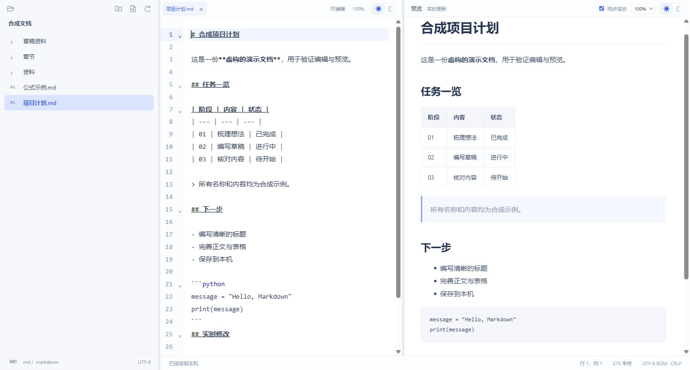

# LLMMarkUp


**简洁、顺手的 Markdown 编辑器。**

文件夹、多标签、实时预览和公式支持，打开就写，用完就存。

面向本地笔记、技术文档和公式写作：用文件树整理资料，用多标签编辑 Markdown，在旁边即时查看排版与 LaTeX 公式。不需要账号、模型服务或本地 Web 服务，文档保存在自己的目录中。

**English:** LLMMarkUp is a simple, easy-to-use Markdown editor for Windows with a file tree, multiple tabs, live preview and LaTeX math. It works offline without accounts, telemetry or cloud services. The desktop application currently has a Chinese interface.

[项目网站 / Website](https://ai-v5.github.io/LLMMarkUp/) · [使用与构建](#快速开始) · [功能边界](#功能边界) · [AGPL-3.0-only](LICENSE)



## 可以做什么

| 能力 | 当前支持 |
| --- | --- |
| 文件组织 | 目录懒加载，新建 Markdown/子目录，重命名、复制完整路径、树内移动、移至系统回收站 |
| 多标签编辑 | 保留草稿、撤销历史、光标与滚动位置；关闭标签、切换目录和退出时检查相关未保存内容 |
| 即时预览 | 标题、表格、列表、代码块、只读任务列表、脚注及预览内部跳转 |
| 数学公式 | KaTeX 离线渲染，支持矩阵、多行对齐、分段、积分与求和 |
| 阅读与布局 | 明暗主题、可拖拽栏宽、编辑区与预览区独立缩放（50%～200%）、编辑驱动的同步滚动 |
| 本地文件保护 | 保留 UTF-8 BOM 与 LF/CRLF；检测外部修改，冲突时拒绝覆盖 |
| 打开记录 | 最近文件/目录各 12 项，最多 50 个标签；重启恢复有效打开记录和界面状态 |

## 快速开始

当前版本 **0.6.1**，面向 **Windows x64**。仓库尚未发布二进制 Release，请从源码构建。开发需要 Node.js 22.12+ 和 npm；安装后的应用不需要 Node.js 或 Python。

```powershell
git clone https://github.com/ai-v5/LLMMarkUp.git
Set-Location LLMMarkUp
npm ci
npm start
```

生成本机安装包：

```powershell
npm run dist
```

产物为 `outputs/installers/LLMMarkUp-0.6.1-Setup.exe`。构建显式使用 `--publish never`，不会上传产物或创建 Release。**安装包尚未进行代码签名**，Windows 可能显示未知发布者或 SmartScreen 提示。

开发者更新已有本机安装可执行 `npm run dist:local`。脚本核验安装归属，正常请求关闭，原位安装并校验版本和应用包 hash 后重新打开；如有未保存提示，需先处理，脚本不会强杀。首次安装默认使用当前用户 Programs 目录。指定位置可运行：

```powershell
powershell -File install-local.ps1 -InstallDirectory '<目标目录>' -Launch
```

## 日常使用

打开文件夹后，点击文件树中的 `.md` 或 `.markdown` 文件。右键目录或空白处新建文件/子目录，右键文件进行重命名、复制路径、移动或回收站删除。

| 快捷键 | 操作 |
| --- | --- |
| `Ctrl+O` | 打开文件夹 |
| `Ctrl+N` / `Ctrl+Shift+N` | 新建 Markdown / 新建目录 |
| `Ctrl+S` | 保存当前文件 |
| `Ctrl+W` | 关闭当前标签 |
| `Ctrl+F` | 查找 |
| `Ctrl+R` | 重新读取磁盘文件，先处理未保存内容 |

编辑区和预览区各自支持触控板捏合或 `Ctrl+滚轮` 缩放；点击编辑区百分比恢复 100%。左上角“打开”菜单提供最近文件和目录。

公式支持 `$...$`、`\(...\)`、`$$...$$`、`\[...\]` 和 `math` 围栏，具体语法受 KaTeX 支持集限制。预览支持不带属性的 `<br>`、`<br/>` 和 `<br />` 换行；其他文档 HTML 显示为文本。任务列表在预览中只读，修改仍通过源码。

重命名保持标签顺序、活动项、未保存内容和撤销历史，正文仍需 `Ctrl+S` 保存。移动限于当前目录树、同一文件系统，不覆盖已有目标。删除需要确认并处理未保存内容；回收站不可用时报告失败，不降级为永久删除。复制路径写入系统剪贴板，成功提示在 2.5 秒后消失。

## 功能边界

- 支持不超过 **2 MiB** 的 UTF-8 文档；拒绝其他编码、混合/旧式换行、目录越界及子路径中的符号链接/目录联接。
- 应用无账号、遥测、模型 API、云同步或联网下载更新。图片显示占位，外部链接不可导航；预览仅加载随应用打包的资源，禁止文档发起网络请求、读取任意文件、执行 HTML 或打开窗口。
- 尚未实现图片预览、Mermaid、崩溃草稿恢复和多人协作。**未保存正文仅在内存中，异常退出可能丢失**；打开记录不等于草稿备份。
- 文件操作有版本和冲突检查，但与不协作的外部程序之间仍有最终检查到文件系统操作的竞争窗口，不提供多写入者事务保证。避免同时用多个程序修改同一个文件。
- 配置位于 Electron 标准 `userData/studio-session.json`，记录本机目录、最近文件与界面状态，不存储未保存正文。分享配置或截图前请检查路径信息。

早期 MDPPT Studio 用户升级时，仅在新配置不存在时从既定旧文件迁移有效字段，保留原件，不覆盖已有新配置。安装身份沿用升级标识，界面、EXE、快捷方式及新安装目录使用 LLMMarkUp。

## 开发、测试与项目结构

```powershell
npm test
npm run test:e2e
npm run pack
```

对刚构建的 EXE 运行同一端到端测试：

```powershell
$env:LLMMARKUP_TEST_EXE = (Resolve-Path 'outputs/installers/win-unpacked/LLMMarkUp.exe').Path
node --test tests/e2e.cjs
Remove-Item Env:\LLMMARKUP_TEST_EXE
```

测试使用合成临时文件及 `LLMMARKUP_TEST_DATA` 隔离配置，迁移测试仅使用显式合成旧配置，不读取用户资料。

| 文件 | 职责 |
| --- | --- |
| `main.cjs` / `preload.cjs` | Electron 窗口、受限 IPC、权限与资源加载边界 |
| `workspace.cjs` / `session.cjs` | 文件操作、冲突检查、打开记录与配置迁移 |
| `renderer.js` / `preview.mjs` | CodeMirror 编辑、交互与 Markdown/KaTeX 预览 |
| `build.mjs` / `install-local.ps1` | 离线资源打包、第三方通知与本机升级 |
| `docs/` | GitHub Pages 静态项目网站；发布源为 `main:/docs` |

本轮文档与网站更新复验基于 0.6.1：28 项单元测试、4 项开发窗口 E2E 和 4 项打包 EXE E2E 通过；2026-10-26 依赖在线审计为 0 项已知漏洞。打包 EXE 验证不等于安装升级验证；本轮未重新安装应用。物理触控板、真人输入法、多个 Windows 版本、代码签名及 SmartScreen 行为未在本轮验证。未来依赖风险需持续复核。

## 开源许可与贡献

项目自有代码和原创图标采用 [GNU AGPL v3，仅第 3 版](LICENSE)（`AGPL-3.0-only`）。第三方组件保留自身许可；KaTeX 字体保留 [OFL-1.1](licenses/KaTeX-FONTS-OFL.txt)，参见 [NOTICE](NOTICE)。构建会从实际 bundle 生成 `THIRD_PARTY_NOTICES.txt`，对应源码、构建脚本与锁文件均在本仓库。“帮助 → 关于 LLMMarkUp”可查看版本、许可与源码地址。

欢迎通过 [Issue](https://github.com/ai-v5/LLMMarkUp/issues) 提供复现步骤和预期行为，通过 PR 提交范围明确的修改。请使用合成样例并运行相关测试，不提交用户文档、配置、日志、安装包或凭据。漏洞请通过 [私密报告入口](https://github.com/ai-v5/LLMMarkUp/security/advisories/new) 报告；入口不可用时，不要改用公开 Issue 披露未修复漏洞或有效凭据。
